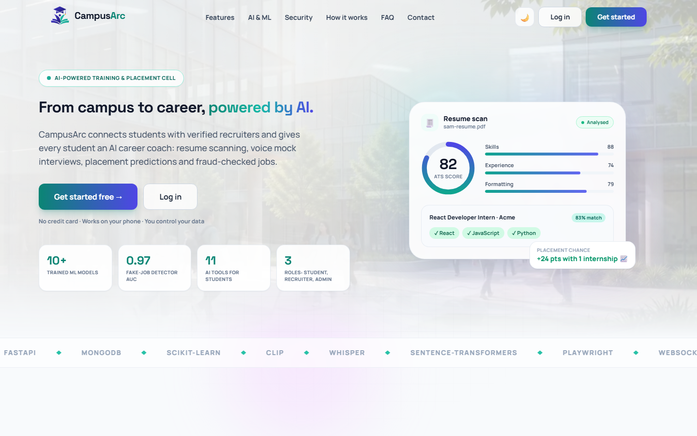
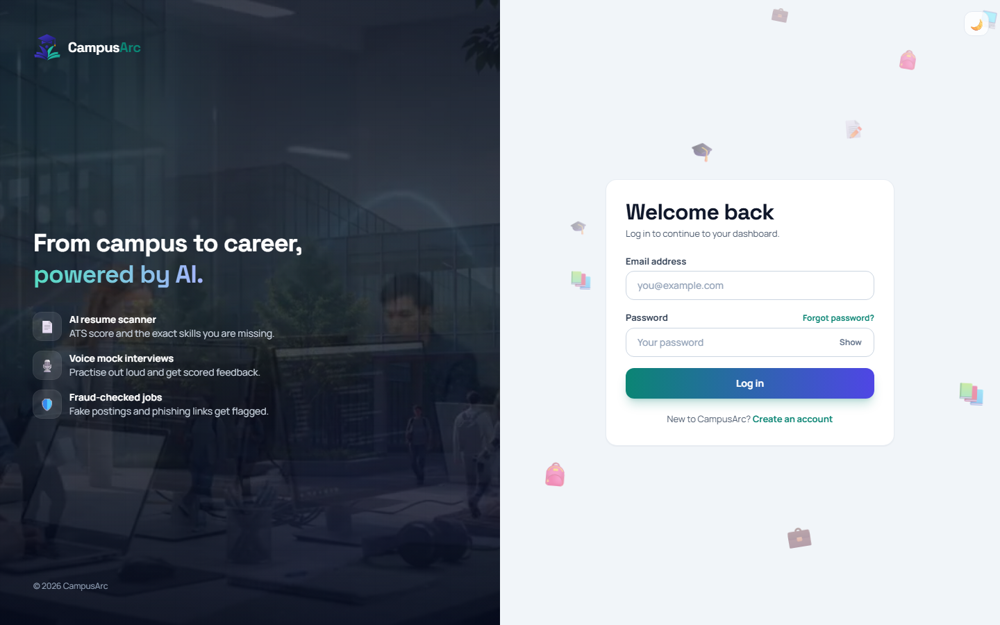
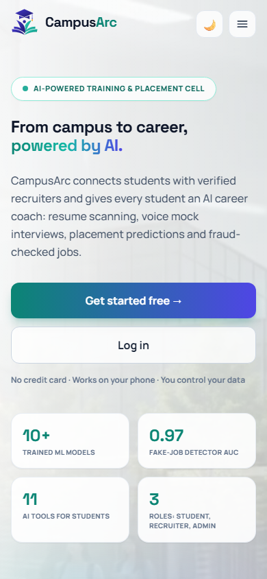

# CampusArc-AI

**An AI-powered Training & Placement Cell platform.** Students get an AI career coach (resume scanner, adaptive mock interviews, placement and salary estimates, skill-gap guidance); recruiters get verified candidates, job fairs and fraud-screened postings; admins get a control room with live ML metrics.

A full-stack project on **FastAPI + MongoDB + React**, with real ML models trained and served locally.

<p align="center">
  
</p>

<p align="center">
  
  &nbsp;
  
</p>

> **Status:** feature-complete for local use and demos. It has not been deployed or load-tested. See [Limitations](#limitations-and-honest-notes).

---

## Table of contents

1. [Highlights](#highlights)
2. [Features by role](#features-by-role)
3. [Tech stack](#tech-stack)
4. [Architecture](#architecture)
5. [Machine learning](#machine-learning)
6. [Getting started](#getting-started)
7. [Configuration](#configuration)
8. [Testing](#testing)
9. [Project structure](#project-structure)
10. [Security and privacy](#security-and-privacy)
11. [Limitations and honest notes](#limitations-and-honest-notes)
12. [Credits](#credits)

---

## Highlights

- **Three role-based dashboards** (student, recruiter, admin), mobile-first, with light and dark themes.
- **12 trained or algorithmic ML components** served locally (Random Forest, Gradient Boosting, Isolation Forest, K-Means, Logistic Regression, MLP, MinHash, TF-IDF, sentence embeddings, CLIP). Metrics are measured on held-out data and shown to admins, including where the models are weak.
- **LLM features through any OpenAI-compatible API** (Groq by default): resume analysis, adaptive mock interview grading, cover letters, career assistant. The API key never reaches the browser.
- **Safety tooling:** fraud screening for every job posting, deepfake checks for photos and videos, a phishing-URL model, and a **disposable browser** that opens suspicious links in an isolated Chromium behind an SSRF guard.
- **Server-side access control** in one auditable file (`backend/app/policy.py`), real-time updates over WebSockets, TOTP two-factor authentication, and GDPR-style data export and erasure.

## Features by role

| Role | What they can do |
|---|---|
| **Student** | Dashboard with readiness score, placement chance, applications and upcoming interviews. Job board with **AI-recommended jobs** and skill-match scores. One-click apply with an **AI cover letter** grounded in the profile. Courses with lesson progress, resource library, company profiles. **Resume Scanner**, **Mock Interview** (typed or voice answers), **Career Insights**, **Resume Builder** (PDF export), **Verify Media and Links**. Job fairs with bookable interview slots, live Q&A, chat. |
| **Recruiter** | Post, edit and close jobs (each is screened by the fraud model). Applicant tracking with a status workflow and **AI candidate ranking**. Candidate search. Create job fairs, run a booth with interview slots, host live Q&A sessions, chat with students. Hiring funnel analytics and CSV export. |
| **Admin** | Platform overview and placement analytics. User management. Review queue for high-risk jobs. Content management for courses, lessons, resources and companies. **ML Models** page with live metrics and "try it" tools. **Integrity** page for duplicate resumes and unusual accounts. |

Cross-cutting: in-app notifications with live updates, optional e-mail notifications (SMTP), calendar (.ics) export for interviews, an AI career assistant widget, dark mode.

## Tech stack

| Layer | Technology |
|---|---|
| Frontend | React 19, Vite 7, React Router 7, Tailwind CSS 3.4, Framer Motion, react-hot-toast, react-markdown |
| Backend | Python 3.13, FastAPI, async PyMongo, Pydantic v2, JWT (PyJWT) + bcrypt, slowapi (rate limiting), WebSockets |
| Database | MongoDB (Atlas free tier is enough) with TTL indexes for temporary data |
| AI | Any OpenAI-compatible provider (default: **Groq**, `openai/gpt-oss-120b`; speech-to-text `whisper-large-v3-turbo`) |
| ML | scikit-learn, sentence-transformers (`all-MiniLM-L6-v2`), CLIP, OpenCV, imagehash, joblib |
| Safety | Playwright (disposable Chromium), custom SSRF guard, pyotp (TOTP), cryptography (encrypted MFA secrets) |
| Tests | pytest (54 tests: API, privilege escalation, booking races, security, ML, media, safe-link) |

## Architecture

```
                 ┌────────────────────────┐
 Browser ──────▶ │ React app (Vite)       │   /api and /ws are proxied in development
                 └───────────┬────────────┘
                             │ REST + WebSocket (JWT)
                 ┌───────────▼────────────┐        ┌──────────────────────────┐
                 │ FastAPI                │ ─────▶ │ MongoDB (Atlas)          │
                 │  policy.py  (who may   │        └──────────────────────────┘
                 │   read/write what)     │        ┌──────────────────────────┐
                 │  routers/   (REST, AI, │ ─────▶ │ LLM provider (Groq, ...) │
                 │   ML, media, safe-link)│        └──────────────────────────┘
                 │  ml/        (models)   │        ┌──────────────────────────┐
                 │  sandbox.py (Chromium) │ ─────▶ │ Isolated headless browser │
                 └────────────────────────┘        └──────────────────────────┘
```

Design decisions worth knowing:

- **One policy layer.** `backend/app/policy.py` decides who may read, create, update and delete every collection. Ownership fields such as `studentId` or `recruiterId` are always set by the server and never trusted from the client. The generic CRUD router (`routers/crud.py`) exposes collections through those policies, so adding a field cannot silently open a hole.
- **Atomic operations live in `routers/special.py`:** chat start, joining a fair, slot booking (two students can never get the same slot), aggregates.
- **Real-time without data leaks.** The WebSocket hub only announces *that* a room changed; the browser then re-fetches through the normal authorised REST API.
- **Swappable AI provider.** Change `LLM_BASE_URL`, `LLM_MODEL` and `LLM_API_KEY` to use Groq, xAI Grok, OpenAI or any compatible service. The client also handles reasoning models that spend tokens on hidden thinking.
- **ML is served in-process** with models loaded once at start-up (warm-up in the lifespan hook) and run in worker threads so the event loop stays responsive.

## Machine learning

Everything below is trained on public Kaggle datasets and shipped in `backend/ml/models/` (about 100 MB in total, so the app works without retraining). The admin **ML Models** page shows these metrics live. All numbers are on held-out data.

| Model | Method | Data | Result |
|---|---|---|---|
| Fake job detector | Random Forest on TF-IDF plus engineered features, isotonic calibration | *Real / Fake Job Posting* (17,880 postings, 4.8% fraud) | ROC-AUC **0.974**, precision 0.83, recall 0.64 (heavily imbalanced, so accuracy is not reported) |
| Anomaly detector (postings) | Isolation Forest trained on legitimate postings only | same | Unsupervised. Flagged postings are about 3.3x more likely to be fraud (14.4% vs 4.3%). ROC-AUC against fraud labels 0.65: a weak signal, used as a secondary hint |
| Resume category | TF-IDF (full text plus first line) into a Logistic Regression + Random Forest soft-voting ensemble, trained with title-removed and shortened copies and 240 template-built software-fresher resumes | *Resume Dataset* (2,483 resumes, 24 classes) | **80.9%** on dataset-style resumes, **70.0%** with the job title removed, **66.8%** for short resumes (see note below) |
| Placement probability | Monotonic gradient boosting (more CGPA or internships can never lower the score), probabilities shrunk into 5-95% | *Engineering Placements* (1,137 students; gender, age and hostel excluded on purpose) | ROC-AUC **0.883**, accuracy 78.3%, 5-fold CV AUC 0.868 |
| Salary estimate | Ridge regression on log-salary, shown as an 80% interval | *Engineering Graduate Salary* (2,980 rows, INR) | CV R² 0.21: modest by nature, hence a range, not a number |
| Job families | TF-IDF, SVD, **K-Means** (k = 16 chosen by silhouette) | job-posting corpus (16.9k legitimate postings) | Unsupervised; used for filters and badges |
| Semantic matching | `all-MiniLM-L6-v2` embeddings blended 60/40 with skill overlap | n/a | Job recommendations, resume-to-job match, similar jobs, AI candidate ranking |
| Duplicate resumes | MinHash on 5-word shingles plus embedding cosine | n/a | Flags copy-pasted or paraphrased resumes for admin review |
| Suspicious accounts | Isolation Forest on behaviour features (application rate, bursts, profile fill, match quality) | live data (synthetic prior until 40 students exist) | Scores are percentiles: "unusual", not "guilty" |
| Deepfake detector | Stacked ensemble: CLIP embeddings with logistic regression and an MLP, plus a forensic Random Forest | *Deepfake and Real Images* (12k train, official 2k test) | ROC-AUC **0.885**, accuracy 79.5%. The forensic and Isolation Forest parts are weak on this data (0.59, 0.47); the CLIP models do the real work |
| Phishing URL model | Random Forest on lexical features plus character n-gram logistic regression | *Phishing Site URLs* (about 507k) | ROC-AUC **0.991**, F1 0.96 |
| Interview answer check | Embedding similarity to the ideal answer, key-point coverage and an answer-depth factor | n/a | A second opinion next to the LLM grade, not a correctness check |
| Skill extraction | Vocabulary mined from 2,400 resumes plus longest-phrase matching | *Resume Dataset* | No LLM, microseconds |

**How the models are used.** Every job is screened when created or edited: high-risk postings stay hidden from students until an admin approves them. The resume scanner shows a predicted career category and the semantic similarity to a chosen job. Students get embedding-based job recommendations and recruiters can rank all students for a role. Only features that exist on the platform (title, description, skills, salary, location) go into the fraud models, so training and serving see the same inputs.

**About the resume classifier.** The dataset's resumes start with a job title in capitals, while real resumes start with a name and contact line, and the dataset's IT resumes are help-desk style rather than React/Node. The first version was confidently wrong on real fresher resumes. The shipped model is trained with title-removed and shortened copies of the training resumes (held-out resumes are never augmented) and with template-built software-fresher resumes. On the same unseen resumes this lifts the title-removed accuracy from 67.0% to 70.0% and short resumes from 64.8% to 66.8%, at a cost of about 4 points on dataset-style resumes (85.1% to 80.9%). Because the synthetic resumes are templated, the improvement on software resumes is partly optimistic. The UI shows a "low confidence" note whenever the top class is below 35%.

**About the placement model.** The Kaggle dataset only contains whole-number CGPAs (5 to 9) with sharp thresholds, so a raw model is a staircase and can output 0% or 100%. The app interpolates between whole-number CGPAs, enforces monotonic behaviour and shrinks the displayed probability into 5-95%. Treat it as a directional estimate, not a prediction of any individual's outcome.

**Not included on purpose:** a "hire likelihood" predictor. It needs real hiring outcomes, which this platform does not have yet, and training it on made-up data would be misleading.

### Retraining

Training data is not in the repository (it is large and belongs to its authors). With a [Kaggle API token](https://www.kaggle.com/docs/api) in `~/.kaggle`:

```bash
cd backend
kaggle datasets download -d snehaanbhawal/resume-dataset                       -p ml/data/resume_raw     --unzip
kaggle datasets download -d shivamb/real-or-fake-fake-jobposting-prediction    -p ml/data/fakejobs_raw   --unzip
kaggle datasets download -d tejashvi14/engineering-placements-prediction       -p ml/data/placement_raw  --unzip
kaggle datasets download -d manishkc06/engineering-graduate-salary-prediction  -p ml/data/salary_raw     --unzip
kaggle datasets download -d taruntiwarihp/phishing-site-urls                   -p ml/data/phishing_raw   --unzip
kaggle datasets download -d manjilkarki/deepfake-and-real-images               -p ml/data/deepfake_raw   --unzip   # 1.8 GB

python -m ml.train_all          # resume classifier + fake-job and anomaly models
python -m ml.train_placement
python -m ml.train_salary
python -m ml.train_families
python -m ml.train_phishing
python -m ml.train_deepfake
```

## Getting started

**Prerequisites:** Python 3.11+ (developed on 3.13), Node 18+ (developed on 22), a MongoDB connection string (a free Atlas M0 cluster works), and an LLM API key (a free key from [Groq](https://console.groq.com) works).

### 1. Backend

```bash
cd backend
python -m venv .venv
.venv\Scripts\activate                 # macOS/Linux: source .venv/bin/activate
pip install -r requirements.txt
python -m playwright install chromium  # only needed for the disposable browser feature

cp .env.example .env                   # then edit .env (see Configuration)
python -c "import secrets;print(secrets.token_urlsafe(48))"   # use the output as JWT_SECRET

uvicorn app.main:app --port 8000       # add --reload while developing
```

The first start downloads the sentence-embedding model (about 90 MB) and the CLIP model from Hugging Face, so it takes a few minutes once. Interactive API docs are at <http://localhost:8000/docs>.

### 2. Frontend

```bash
cd frontend
npm install
npm run dev                            # http://localhost:5173 (proxies /api and /ws to :8000)
```

For a production build run `npm run build` and set `VITE_API_URL` to the backend URL, or serve both behind one domain.

### Useful scripts

| Command (from `backend/`) | Purpose |
|---|---|
| `python -m scripts.wipe_test_data` | show document counts |
| `python -m scripts.wipe_test_data --yes` | delete only `pytest-*` test users and their records |
| `python -m scripts.wipe_test_data --everything --confirm-db <name>` | empty every collection (refuses without the matching database name) |

## Configuration

All settings live in `backend/.env` (never committed; `.env.example` is the template).

| Variable | Purpose |
|---|---|
| `MONGODB_URI`, `MONGODB_DB` | database connection and name |
| `JWT_SECRET` | signs access and refresh tokens; required, use a long random value. MFA secrets are encrypted with a key derived from it |
| `ACCESS_TOKEN_MINUTES`, `REFRESH_TOKEN_DAYS` | token lifetimes |
| `CORS_ORIGINS`, `FRONTEND_URL` | allowed browser origins, and the link base used in e-mails |
| `LLM_PROVIDER`, `LLM_API_KEY`, `LLM_BASE_URL`, `LLM_MODEL` | AI provider (Groq by default; xAI Grok is `https://api.x.ai/v1`) |
| `STT_MODEL` | speech-to-text model for voice answers (default `whisper-large-v3-turbo`) |
| `AI_CALLS_PER_10MIN` | per-user AI rate limit |
| `SMTP_HOST`, `SMTP_PORT`, `SMTP_USER`, `SMTP_PASSWORD`, `SMTP_FROM` | optional; without SMTP, reset links and notification mails are only printed in the server log |

## Testing

```bash
cd backend
python -m pytest -q          # 54 tests
```

The suite covers authentication, privilege escalation attempts, booking races, chat privacy, MFA, the SSRF guard, the safe-link and media pipelines, and the ML models. API tests create throw-away accounts (`pytest-...`) in the configured database and delete them afterwards, so **point `.env` at a development database, not production data**.

## Project structure

```
backend/
  app/
    main.py              FastAPI app, CORS, security headers, model warm-up
    config.py            settings from .env
    policy.py            access rules for every collection
    routers/             auth, crud (generic, policy-checked), special, ai, ml, insights,
                         media, safe, security, reports, integrity, ws
    ai/                  LLM client, resume text extraction, skill matching
    sandbox.py, ssrf.py  disposable browser and its SSRF guard
    mfa.py, notify.py, mailer.py
  ml/
    train_*.py           one trainer per model
    service.py           inference used by the API
    models/              trained models and metrics_*.json
    data/                training data (gitignored; see Retraining)
  scripts/               maintenance helpers (test-data cleanup)
  tests/                 pytest suite
frontend/
  src/
    components/          app shell (sidebar, bottom tabs), dashboards, landing sections, brand logo
    pages/               one file per screen
    lib/api.js           API client with transparent JWT refresh and a shared WebSocket
    contexts/, hooks/    auth and theme state, "load and refresh on server events" hook
docs/screenshots/        images used in this README
```

## Security and privacy

- **Authentication:** bcrypt password hashing, short-lived access tokens with refresh tokens that are re-issued on every refresh, login rate limiting, no self-registered admins, optional **TOTP two-factor authentication** with recovery codes, replay protection and lock-out.
- **Authorisation:** enforced on the server for every collection and action (see `policy.py`); the client is never trusted for ownership or roles.
- **Safe link checking:** the disposable browser uses a fresh headless Chromium context per request, refuses downloads, runs with JavaScript off by default, and every request (including redirects and sub-requests) passes an **SSRF guard** that allows only public http/https targets on ports 80 and 443 with resolved IPs verified.
- **Media checks:** file types are judged by their bytes, size and pixel limits apply, uploads are analysed in memory or in a temp file that is deleted immediately, and optional summary reports (scores only, never the file) expire after 24 hours.
- **Data rights:** users can export everything stored about them and erase their account. Temporary data uses MongoDB TTL indexes.
- **Secrets:** nothing sensitive is committed. `.env`, training data and local tooling state are in `.gitignore`. If you fork this project, generate your own `JWT_SECRET`, and rotate any key you ever pasted into a chat, an issue or a commit.
- **Prompt-injection hygiene:** user-supplied text is fenced and labelled as data in LLM prompts, and AI endpoints are rate-limited per user.

## Limitations and honest notes

- **Not deployed or load-tested.** The WebSocket hub is in-process, so it targets a single server; use Redis pub/sub to scale to several workers. Tokens are kept in `localStorage` and there is no server-side revocation list yet (a refresh token stays valid until it expires); for a hardened deployment use an `httpOnly` cookie and a revocation store.
- **ML quality varies and is shown, not hidden.** The fraud and phishing models are strong on their datasets. The deepfake model was trained on one family of face generators and is a screening signal, not proof. The resume classifier is weaker on real resumes than on its own benchmark (see above). The placement and salary models come from small public datasets and should be read as rough benchmarks.
- **The sandbox makes a malicious site safe to look at, not safe to use.**
- **Accessibility and i18n** have not been audited; the UI is English only.
- Voice answers need browser microphone permission; the live webcam check needs camera permission.
- Ideas for later: Docker setup, OAuth sign-in, OCR for scanned PDFs, a real hiring-outcome dataset for a hire-likelihood model, Playwright end-to-end tests.

## Credits

- Built by [@sufiyan-shah0301](https://github.com/sufiyan-shah0301): backend, ML models and frontend.
- Datasets belong to their respective Kaggle authors; check each dataset's terms before redistributing the trained models.
